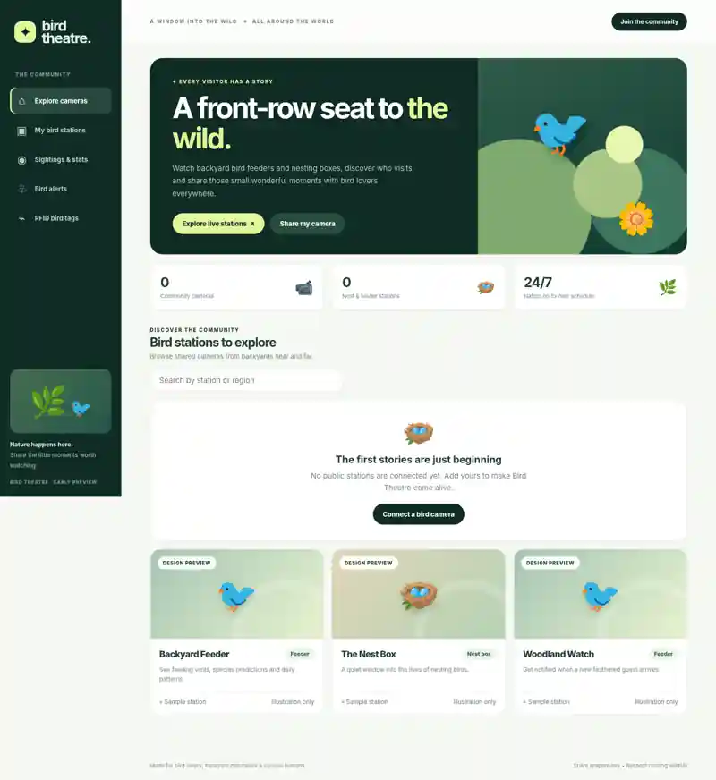
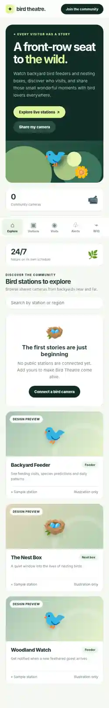

# 🐦 Bird Theatre

**Every visitor has a story.** A community where people share live views of bird feeders and nesting boxes, learn which species visit, monitor estimated arrivals and departures, and optionally identify previously tagged birds with RFID.

> **Early-stage project, not a deployed service.** Independent of [Electrical Workbench](https://github.com/GFH-GhostsFromHell/electrical-workbench). Initial GitHub CI passed for the Spring Boot portal, Windows MSI, iOS simulator, and vision-event tests on November 21, 2026; Android build validation is in progress. A production wildlife AI model installation, live camera gateway, physical RFID readers, mobile push service, and App Store distribution are not included.

## Source, builds and installers

[**GitHub repository**](https://github.com/GFH-GhostsFromHell/bird-theatre) · [**Download Windows Installer (.msi, direct)**](https://github.com/GFH-GhostsFromHell/bird-theatre/releases/latest/download/BirdTheatre-Windows-Setup.msi) · [**Windows MSI build workflow**](https://github.com/GFH-GhostsFromHell/bird-theatre/actions/workflows/build-desktop.yml) · [**Android APK workflow**](https://github.com/GFH-GhostsFromHell/bird-theatre/actions/workflows/build-android.yml) · [**iOS simulator workflow**](https://github.com/GFH-GhostsFromHell/bird-theatre/actions/workflows/build-ios.yml) · [**Web tests**](https://github.com/GFH-GhostsFromHell/bird-theatre/actions/workflows/build-web.yml)

**Windows:** Download the [Bird Theatre Windows Installer directly as an `.msi`](https://github.com/GFH-GhostsFromHell/bird-theatre/releases/latest/download/BirdTheatre-Windows-Setup.msi). **Do not use the Actions/Artifacts ZIP**; Windows installers are now published as direct GitHub Release assets after the MSI and runtime checks pass. Android APKs remain in GitHub Actions artifacts. Developer MSI builds may not be Authenticode-signed, and manual-download releases do **not** enable unattended updates without signed manifests. iOS simulator builds are **not signed iPhone apps**. See [Windows installer and automatic updates](docs/WINDOWS_INSTALLER_AND_UPDATES.md).

## Interface preview

These screenshots were captured locally from the project's browser UI using sample illustration cards and a mocked empty camera list. They are **design previews only**, not evidence of a running production service, live birds or working connected cameras.





## What's included

| Area | Current starter | Required for a complete release |
|---|---|---|
| Community & accounts | Email-verified registration, sign-in, password/username recovery, editable private/public member profiles, personal camera records | Configure SMTP; add production rate limits, anti-abuse monitoring, moderation and reporting |
| Live video | Browser HLS player for authorized HTTPS `.m3u8` URLs | Real HLS hosting/CDN or MediaMTX gateway and streaming credentials |
| Species recognition | **Pretrained Torchvision detector + BioCLIP 2 species recognition edge agent**, legacy ONNX reference; authenticated event API | Install model dependencies/download weights, verify camera hardware and species taxonomy, field calibration |
| Sighting history | Approximate multi-bird tracks with unique event IDs, offline queue, arrival/departure events and 30-day species counts | Real-world tracking validation, uncertainty review, correction/export |
| Alerts | Member rules on owned or public cameras, cooldown, alert inbox, tab-open browser notifications | Mobile push (FCM/APNs), email, offline delivery, per-member subscriptions |
| RFID | Register known tags, serial gateway example, owner-only RFID visit timeline | Compatible reader and authorized pre-existing tags, hardware integration |
| Web | Responsive camera gallery, sign-in/register/recovery screens, member profile settings and tools | Accessibility, localization, moderation, full security hardening |
| Android | Kotlin/Jetpack Compose navigation + shared web portal | Tested signed APK/AAB, native notification service |
| Windows | JavaFX desktop shell, self-contained MSI build, secure Ed25519-verified updates on app exit | Run Windows MSI CI, configure signing keys, test installed upgrades and native video fallback |
| iPhone/iPad | SwiftUI/WKWebView shell with XcodeGen project | Apple Developer signing, on-device testing, TestFlight/App Store |
| Hosting | Dockerized Spring Boot portal, PostgreSQL Render Blueprint | Render deployment, DNS/TLS, DB backups, CDN/streaming infrastructure |

## Architecture

```text
  Bird feeder / nest camera (RTSP or equivalent)
                  |
       Owner-controlled gateway
        (e.g. MediaMTX, HLS/CDN) -----> HTTPS HLS ----> web / Android / iOS / desktop viewers
                  |
       Optional vision edge agent ------> camera device token ------+
                                                                       |
  RFID reader --> serial bridge ----------> camera device token ------+--> Spring Boot API --> PostgreSQL
                                                                       |          |
                                                                       |          +--> public community feed
                                                                       |          +--> sightings & statistics
                                                                       +----------+--> owner's alert inbox
```

The backend **does not proxy livestream video or hold your raw video**. Owners provide HTTPS HLS viewer URLs. Edge scripts run locally on the owner's equipment and submit only event data; neither the web backend nor the sample edge script uploads image frames.

## Project layout

- `portal/` — Java 21/Spring Boot API + responsive HTML/CSS/JavaScript UI.
- `android-client/` — Kotlin + Jetpack Compose Android client.
- `desktop-client/` — Windows JavaFX client, MSI jpackage build and secure auto-update service (startup + periodic checks; installs after app exit).
- `ios-client/` — native SwiftUI shell with a shared WKWebView and XcodeGen project.
- `edge-agent/` — pretrained Torchvision + BioCLIP 2 recognition pipeline, visitor tracker, offline SQLite queue, legacy ONNX reference and serial RFID bridge.
- `.github/workflows/` — web tests and Android APK, Windows MSI and iOS Simulator CI; signed Windows release workflow when publisher keys are configured.
- `render.yaml` and `Dockerfile` — deployment configuration for the application and PostgreSQL.
- `docs/` — architecture, privacy, production and feature roadmap.

## Windows installer and automatic updating (new)

The Windows JavaFX client now has a **self-contained, per-user MSI installer** with a permanent upgrade identity. It checks for new releases **on startup and every four hours**, downloads a **cryptographically verified** MSI in the background, and automatically installs it when Bird Theatre closes (or using **Install update now**). The installer restarts Bird Theatre after a successful upgrade.

**Secure publishing is opt-in:** GitHub Actions publishes the MSI as a direct GitHub Release download even without signing setup; unattended installation is **disabled** until repository release-signing keys are configured. This protects users against modified download metadata or unverified installers. The template's MSI is not Authenticode-signed; Windows may display publisher warnings until a code-signing certificate is configured. GitHub releases must be public for the embedded unauthenticated feed.

**Build/run/publisher-key setup:** [Windows Installer and Automatic Updates](docs/WINDOWS_INSTALLER_AND_UPDATES.md).

## Account registration, profiles and the 404 server error

Bird Theatre uses a standalone account database with a shared profile across its web, Windows, Android and iOS clients. Account features now include login, verified email registration, username/password recovery, editable profile details, profile privacy settings and password changes that revoke previous sessions. This is similar to Electrical Workbench's experience; the two apps do **not** automatically share account credentials.

The Windows client's initial HTTP 404 occurred because the **planned** Bird Theatre Render address was not serving a deployed portal. The updated Windows app opens the account screen and provides **Server settings** for configuring the actual live HTTPS portal URL. See [Account and deployment setup](docs/ACCOUNTS_AND_DEPLOYMENT.md).

**Email verification and recovery need SMTP configured on Render**; until then, registration correctly reports that email delivery isn't set up. Do not put SMTP passwords in source code. The [deployment guide](docs/ACCOUNTS_AND_DEPLOYMENT.md) documents all required environment variables.

## Local web development

Requirements: Java 21 and Maven 3.9 or newer. Run from the repository root:

```bash
mvn -f portal/pom.xml spring-boot:run
```

Open `http://localhost:8080`. For **local development only**, the default database is in-memory H2 and all data is discarded after restart. Running the Docker deployment with `DATABASE_URL` selects PostgreSQL. Do not run a public community on the default H2 setup.

### Hosting on Render

The Render Blueprint provisions a **web service and PostgreSQL**. Review service and database pricing before applying it: `render.yaml` deliberately uses paid/stable plan names rather than assuming free persistent Postgres. Render supplies `DATABASE_URL` securely to the web service. You will still need a separate RTSP-to-HLS gateway or video streaming provider to serve live broadcasts. Neither Render deployment nor the media service has been created by this starter archive.

Deploy after the repository is in GitHub: Render Dashboard → New → Blueprint → select the Bird Theatre repository → review and approve resources. Configure a real custom domain, TLS, backups, media capacity, logs, and alerting before public launch.

## Connect a camera

1. Sign up in the portal, then go to **My bird stations → Add bird station**.
2. Enter a general region (not a street address), choose **Feeder** or **Nest box**, and supply an HTTPS HLS `.m3u8` viewer URL that you have permission to share. A raw `rtsp://...` camera address is **not** a browser stream.
3. Save the **one-time device token** somewhere secure on your camera/edge computer. The platform stores only its SHA-256 hash.
4. Test HLS playback and CORS through your own streaming gateway; use the station's UUID for the optional edge scripts.
5. Add an **ANY**-species alert or a particular species under **Bird alerts** (including stations shared by other members). Alerts appear in your account inbox when the edge agent reports a new arrival.

Sample ingest request from the edge computer:

```bash
curl -X POST 'https://YOUR_PORTAL/api/v1/cameras/YOUR_CAMERA_UUID/detections' \
  -H 'Content-Type: application/json' \
  -H 'X-Device-Token: YOUR_PRIVATE_DEVICE_TOKEN' \
  -d '{"species":"Black-capped Chickadee","eventType":"ARRIVAL","confidence":0.92}'
```

The same camera device token is used for a compatible RFID scanner:

```bash
curl -X POST 'https://YOUR_PORTAL/api/v1/cameras/YOUR_CAMERA_UUID/rfid-scans' \
  -H 'Content-Type: application/json' \
  -H 'X-Device-Token: YOUR_PRIVATE_DEVICE_TOKEN' \
  -d '{"tagUid":"EXAMPLE-RFID-001","eventType":"ARRIVAL"}'
```

**Never commit a real camera device token, RTSP credentials, account passwords, signing keys or a production database URL.** Camera tokens can be rotated under My bird stations. Raw RFID identifiers are private to the owner in API responses and are not included in public sightings.

## Live species recognition (new)

**Ready to configure, not yet tested on real cameras:** The project includes `edge-agent/vision_realtime.py` — an actual two-stage pretrained **bird detector + species recognizer** using Torchvision Faster R-CNN and MIT-licensed BioCLIP 2. It detects *multiple birds per image*, compares each crop with regional candidate species, tracks approximate arrivals/departures and pushes sighting events to the portal with retried, idempotent delivery. It uses the same device token issued when you add a bird station.

The initial Ontario species CSV is **a candidate list, not a complete identification database**. Predictions are fallible, ambiguous sightings are marked **Unidentified**, and the track is temporary; **it does not uniquely identify individual birds**. A real camera, compatible PyTorch/OpenCLIP installations and first-time weight downloads are required; no model checkpoint is bundled or hosted by Bird Theatre.

Start on a camera-side Windows/Linux PC with Python 3.11–3.12:

```bash
cd edge-agent
python -m venv .venv
# activate .venv, then install a matching torch + torchvision pair (see docs)
pip install torch torchvision
pip install -r requirements-vision.txt
# set PORTAL_URL, CAMERA_SOURCE, CAMERA_ID and DEVICE_TOKEN in the environment
python vision_realtime.py
```

**Full setup, calibration, security, licensing and troubleshooting:** [Live bird recognition guide](docs/LIVE_BIRD_RECOGNITION.md). The previous generic ONNX reference is retained as `vision_onnx_reference.py`, still requiring your own trained model and labels.

## Optional RFID monitoring

Register a tag in the **RFID** screen. On a separate device, install the optional Python serial dependency from `edge-agent/requirements.txt`, set `RFID_SERIAL_PORT` and `RFID_BAUD`, and run `python rfid_bridge.py`.

The serial bridge expects text lines such as `TAG123,ARRIVAL` or `TAG123,DEPARTURE`. Physical readers vary considerably, so a protocol decoder or microcontroller adapter may be necessary. **Passive RFID tags are not GPS trackers and can be detected only inside the reader's effective range.** Use only existing authorized tags; do not capture, band, or attach electronic tags to wild birds without required permits and expert training.

For Canadian federal migratory-bird banding, consult the [Canadian Bird Banding Office](https://www.canada.ca/en/environment-climate-change/services/bird-banding/resources-banders-researchers/apply-permit.html). Its guidance includes electronic markers such as RFID tags in permit-related documentation.

## Client builds

Each platform is its own GitHub Actions workflow on `main` (and manual dispatch). From a **successful run**, download:

- `BirdTheatre-Android-Debug-APK` — development APK, not a persistently signed upgrade or Play Store package.
- `BirdTheatre-Windows-MSI` — JavaFX-based Windows installer, not code signed.
- `BirdTheatre-iOS-Simulator` — Simulator-only app, **not** a signed iPhone IPA.
- `BirdTheatre-Web-jar` — tested backend JAR.

Default client URL: `https://bird-theatre.onrender.com`. This address is **a planned deployment target, not a verified active site**. For Android build overrides use Gradle property `-PportalUrl=https://your-portal.example`; for desktop launch use `-Dbirdtheatre.url=https://your-portal.example`. Change the Swift `Theatre.origin` constant when choosing a real iOS backend URL.

## Safety and data accuracy

- A **visit** currently means an ARRIVAL event after short-term per-species deduplication. Multiple birds of the same species cannot be counted accurately without multi-object tracking; arrival and departure events do not prove which individual bird appeared.
- Vision model predictions can be wrong. Preserve confidence scores and allow future correction/review.
- Public camera locations use general regions only. Do not publish exact nest locations, private addresses, protected-species nesting sites, people or neighbouring properties.
- Private listing hides a camera from the API; it **does not** make a separately hosted unprotected HLS URL secret. Use access control at the video provider when privacy matters.
- Passwords are BCrypt-hashed; random bearer sessions expire after 14 days; camera keys are stored as hashes. **Before inviting public users**, add server-side rate limiting, email verification, password recovery, audit trails, session cleanup, CSRF/origin review, moderation/reporting, DB migrations, backups, abuse prevention, load tests, and automated security checks. See `docs/PRODUCTION_READINESS.md`.

## Proposed roadmap

1. Real camera source pairing, MediaMTX/stream-provider integration, stream monitoring and playback health.
2. Validate included bird detector/BioCLIP 2 on real cameras, tune regional species and allow human approval/corrections.
3. Distinguish continuous presence, single visits and individual birds; improve departure logic.
4. Cross-platform notification infrastructure (APNs/FCM, email); alert scheduling and filters.
5. Device onboarding, RFID reader profiles, tag ID access controls and robust edge buffering.
6. Community profiles, favourites, reactions, comments, moderation, accessible viewing experience.
7. Native device testing, signing, app release/version checks and production operations.

## Attribution and license

This project adopts the *architecture style* of Electrical Workbench; it contains new bird-specific implementation rather than a wholesale copy of electrical code. No open-source license has been selected. Add one only after deciding how the software may be reused.
